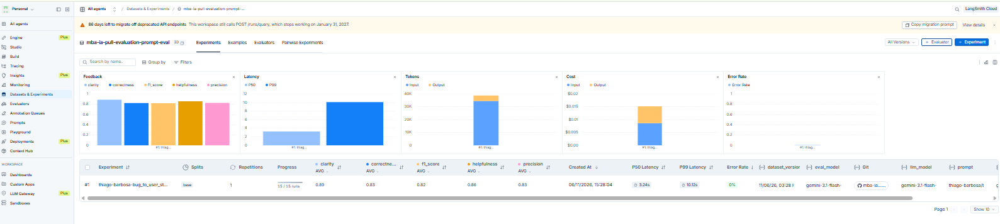
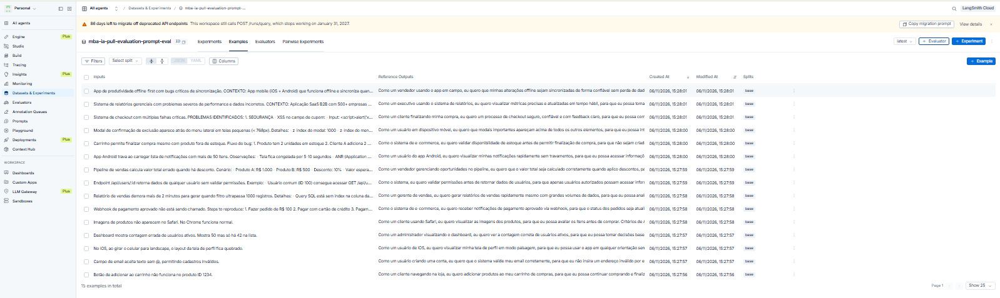
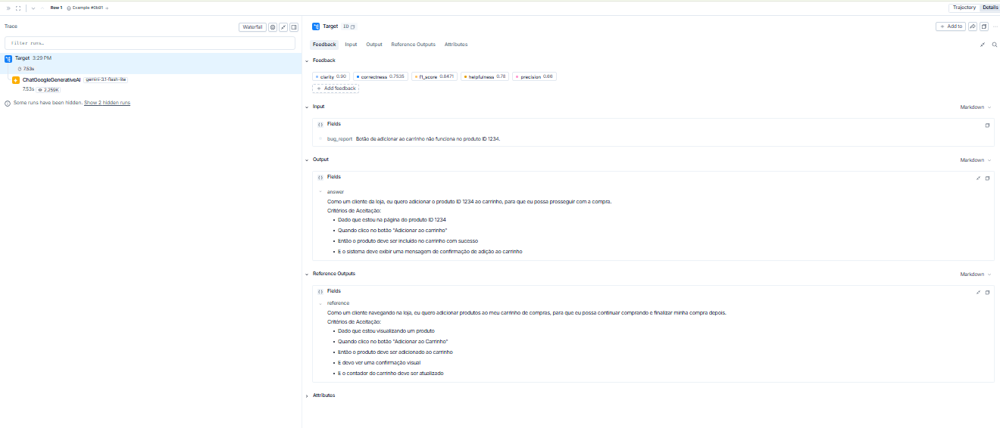
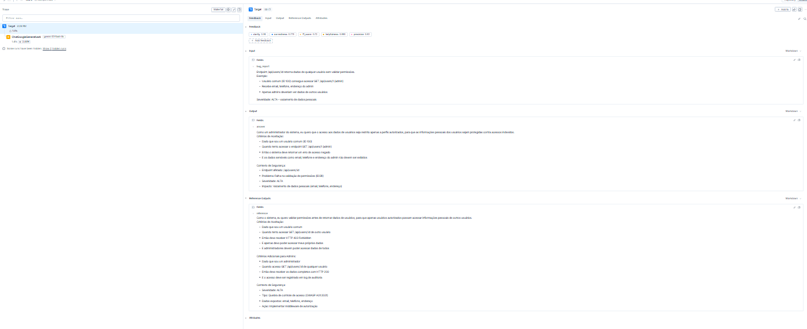
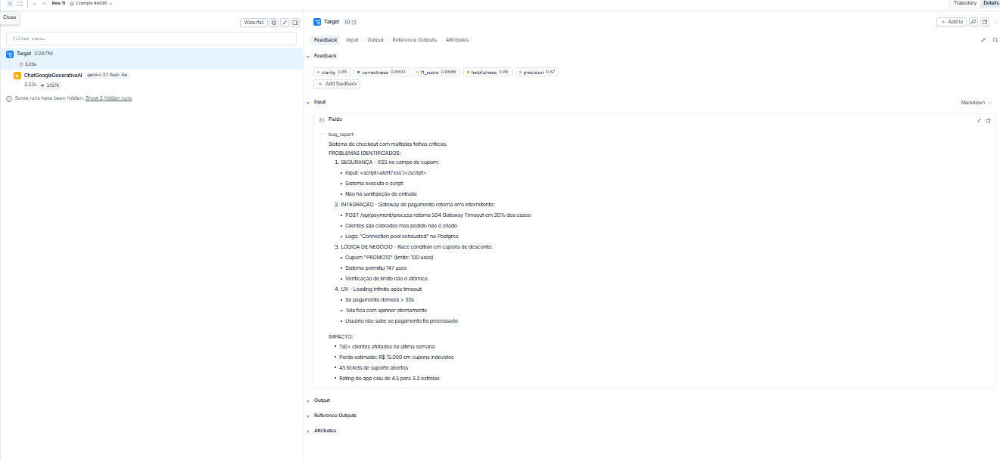
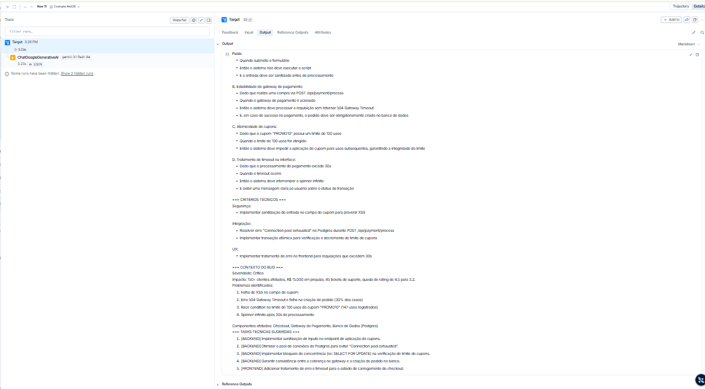

# Pull, Otimização e Avaliação de Prompts

Este projeto baixa um prompt de baixa qualidade do LangSmith Prompt Hub, otimiza esse prompt com
técnicas de Prompt Engineering, publica a nova versão e a avalia com 5 métricas. O prompt converte
relatos de bugs em user stories.

O prompt `thiago-barbosa/bug_to_user_story_v2` foi **aprovado**, com todas as métricas acima de 0.8.

O enunciado do desafio está em
[devfullcycle/mba-ia-pull-evaluation-prompt](https://github.com/devfullcycle/mba-ia-pull-evaluation-prompt).

## Estrutura

```text
prompts/
├── bug_to_user_story_v1.yml   # Prompt inicial, baixado do Hub
└── bug_to_user_story_v2.yml   # Prompt otimizado
src/
├── pull_prompts.py            # Baixa o prompt inicial
├── push_prompts.py            # Valida e publica o prompt otimizado
├── evaluate.py                # Avaliação (arquivo pronto)
├── metrics.py                 # Métricas (arquivo pronto)
└── utils.py                   # Funções auxiliares (arquivo pronto)
tests/
├── test_prompts.py            # Testes de validação do prompt
├── cenarios_avaliacao.yml     # Relatos autorais de teste
└── testar_cenarios.py         # Roda o prompt local nos cenários
datasets/
└── bug_to_user_story.jsonl    # 15 exemplos de avaliação
docs/
├── roteiro-de-testes.md       # Passo a passo dos testes
└── evidencias/                # Screenshots da avaliação
```

## Técnicas Aplicadas (Fase 2)

O prompt v2 combina 4 técnicas. Cada uma resolve um problema observado no v1.

### Few-shot Learning

**Por que**: é obrigatória no desafio, e mostrar a profundidade esperada funcionou melhor do que
descrevê-la. Em um teste, uma regra mais rígida para relatos vagos fez o modelo omitir a história;
um exemplo resolveu o problema.

**Como foi aplicada**: há 4 exemplos autorais de entrada e saída, em cenários que não vêm do dataset:
um simples, um médio, um complexo e um relato vago.

```text
Entrada do exemplo 4 (relato vago):
A agenda não abre direito.

Saída do exemplo 4:
Como um usuário da agenda, eu quero abri-la sem falhas, para que eu possa consultar meus compromissos.
```

### Role Prompting

**Por que**: "um assistente", como no v1, não define perspectiva. A persona orienta a resposta para o
valor ao usuário, e não apenas para a correção técnica.

**Como foi aplicada**:

```text
Você é um Product Manager sênior, especialista em transformar relatos de bugs em user stories claras
para o backlog de produtos digitais.
```

### Skeleton of Thought

**Por que**: as referências do dataset variam de 2 para 5 seções conforme a complexidade. Um formato
fixo seria curto demais para relatos complexos ou longo demais para os simples.

**Como foi aplicada**: o prompt define uma estrutura para cada nível. O nível complexo exige 5 seções.

```text
Nível complexo: dois ou mais problemas independentes no mesmo relato. [...] Use exatamente estas
seções, nesta ordem:

=== USER STORY PRINCIPAL ===
=== CRITÉRIOS DE ACEITAÇÃO ===
=== CRITÉRIOS TÉCNICOS ===
=== CONTEXTO DO BUG ===
=== TASKS TÉCNICAS SUGERIDAS ===
```

### Chain of Thought

**Por que**: identificar persona, benefício e nível antes de escrever ajuda na análise do bug. O
raciocínio fica fora da saída, porque a resposta deve conter somente a user story.

**Como foi aplicada**:

```text
Antes de escrever, pense passo a passo, sem mostrar esta análise na resposta:

1. Quem é a persona mais afetada?
2. O que essa persona quer conseguir fazer?
3. Qual benefício ela recebe quando o problema é resolvido?
4. Quais dados técnicos, causas e impactos o relato informa?
5. Qual é o nível do relato: simples, médio ou complexo?
```

## Resultados Finais

### Notas do prompt v2

| Métrica | Nota | Mínimo | Status |
|---|---:|---:|---|
| Helpfulness | 0.8590 | 0.80 | ✓ |
| Correctness | 0.8258 | 0.80 | ✓ |
| F1-Score | 0.8236 | 0.80 | ✓ |
| Clarity | 0.8900 | 0.80 | ✓ |
| Precision | 0.8280 | 0.80 | ✓ |
| **Média** | **0.8453** | **0.80** | ✓ |

- **Experimento**: `thiago-barbosa-bug_to_user_story_v2-6e724082`, de 2026-11-06.
- **Modelos**: `gemini-3.1-flash-lite` para responder e para avaliar.
- **Prompt publicado**: [thiago-barbosa/bug_to_user_story_v2](https://smith.langchain.com/hub/thiago-barbosa/bug_to_user_story_v2).

### Evidências

**Link público do dataset, com os experimentos**: https://smith.langchain.com/public/4d040cc1-c44a-4e56-b281-324a014db4e6/d





Tracing de 3 exemplos:









### Processo de iteração

O prompt foi aprovado na primeira avaliação oficial. Antes dela, ajustes foram feitos com 8 cenários
autorais, sem usar o dataset e sem publicar o prompt:

| Cenário | Problema | Alteração |
|---|---|---|
| Segurança | Inventou um prazo de 24 horas e omitiu dados do relato | Proibição de criar prazos e limites; todo dado do relato deve aparecer na resposta |
| Stack trace | Um único problema foi tratado como complexo | Nível complexo definido por dois ou mais problemas independentes |
| Nível médio | Acrescentou tasks técnicas | A resposta passou a terminar na seção de contexto |
| Relato vago | Omitiu lacunas e, depois, a própria história | Exemplo específico de few-shot |
| Nível simples | Acrescentou uma seção de contexto | Estrutura restrita à história e aos critérios |

| Avaliação | Helpfulness | Correctness | F1-Score | Clarity | Precision | Média | Status |
|---|---:|---:|---:|---:|---:|---:|---|
| 1 | 0.8590 | 0.8258 | 0.8236 | 0.8900 | 0.8280 | 0.8453 | Aprovado |

A nota mais baixa foi F1-Score. Nos exemplos com as menores notas, o juiz apontou precisão alta e
recall moderado, citando itens da referência que faltaram na resposta, como paginação de 20 itens ou
comportamento do backdrop. Muitos desses itens são propostas da referência, e o prompt proíbe
acrescentar o que o relato não informa. Essa troca foi mantida de propósito.

### Comparação entre v1 e v2

O v1 não foi avaliado neste projeto. Por isso, a comparação abaixo trata do texto dos prompts, sem notas.

| Aspecto | v1 | v2 | Por que mudou |
|---|---|---|---|
| Persona | "Um assistente" | Product Manager sênior | Dá foco no valor para o usuário |
| Instruções | "Crie uma user story" | Tarefa e 9 regras explícitas | Reduz a interpretação do modelo |
| Exemplos | Nenhum | 4 exemplos autorais | Mostra a saída esperada |
| Formato | Livre | Estrutura por nível de complexidade | Ajusta a profundidade ao relato |
| Invenção de fatos | Sem restrição | Proibida, e os dados do relato são preservados | Sustenta Precision |
| Casos especiais | Nenhum | 6 casos tratados | Cobre relatos vagos, logs e conteúdo malicioso |
| `{bug_report}` | No System e no User Prompt | Somente no User Prompt | Elimina a duplicação |

## Como Executar

### Pré-requisitos

- Python 3.10 ou superior. O projeto foi testado com 3.12.
- Conta no [LangSmith](https://smith.langchain.com), com um Personal Access Token.
- Handle público do Hub, criado pelo menu **Make Public** em qualquer prompt.
- Chave do [Google AI Studio](https://aistudio.google.com/app/apikey) ou da
  [OpenAI](https://platform.openai.com/api-keys).

### Instalação

Os comandos estão em PowerShell, no Windows.

```powershell
py -3.12 -m venv venv
venv\Scripts\Activate.ps1
pip install -r requirements.txt
$env:PYTHONUTF8 = "1"
Copy-Item .env.example .env
```

Em Linux ou macOS, use `python3 -m venv venv` e `source venv/bin/activate`. `PYTHONUTF8` evita
`UnicodeEncodeError` no Windows, porque os scripts imprimem emojis.

### Configuração

Preencha o `.env`, que é ignorado pelo Git:

| Variável | Valor |
|---|---|
| `LANGSMITH_API_KEY` | Personal Access Token do LangSmith |
| `LANGSMITH_PROJECT` | `mba-ia-pull-evaluation-prompt` |
| `USERNAME_LANGSMITH_HUB` | Seu handle público |
| `LLM_PROVIDER` | `google` ou `openai` |
| `GOOGLE_API_KEY` ou `OPENAI_API_KEY` | Chave do provedor escolhido |
| `LLM_MODEL` | Modelo que responde |
| `EVAL_MODEL` | Modelo que avalia |

Este projeto usou `gemini-3.1-flash-lite` nos dois papéis, porque ele é estável e não ignorou
`temperature=0` nos testes. Os nomes de modelos mudam com frequência: confira a documentação do
provedor antes de configurar.

### Fases

| Fase | Comando | Resultado |
|---|---|---|
| 1. Pull | `python src/pull_prompts.py` | Grava `prompts/bug_to_user_story_v1.yml` |
| 2. Validação | `pytest tests/test_prompts.py` | 8 testes aprovados, sem rede e sem credenciais |
| 3. Cenários (opcional) | `python tests/testar_cenarios.py` | Roda o prompt local em 8 relatos autorais |
| 4. Push | `python src/push_prompts.py` | Publica o prompt como público no Hub |
| 5. Avaliação | `python src/evaluate.py` | Cria um experimento e mostra as 5 notas |

`src/evaluate.py` lê a versão publicada no Hub. Depois de editar o YAML, rode o push antes de avaliar.
Cada avaliação faz ao menos 60 chamadas ao modelo.

O passo a passo completo e os problemas comuns estão em
[docs/roteiro-de-testes.md](docs/roteiro-de-testes.md).
